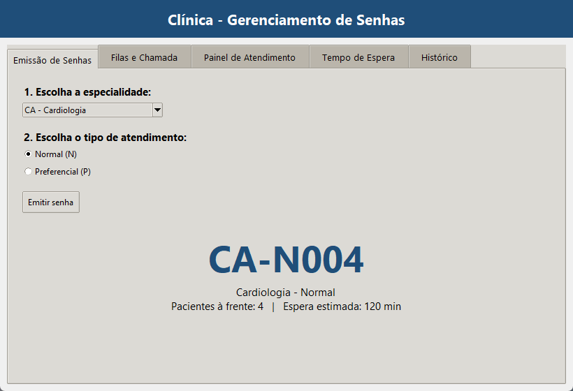
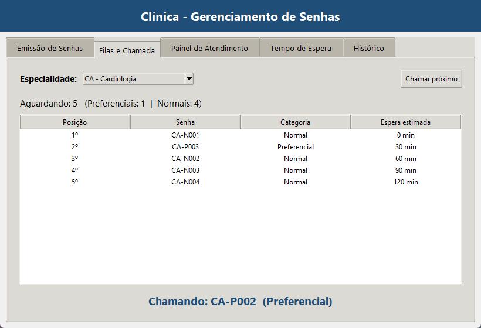
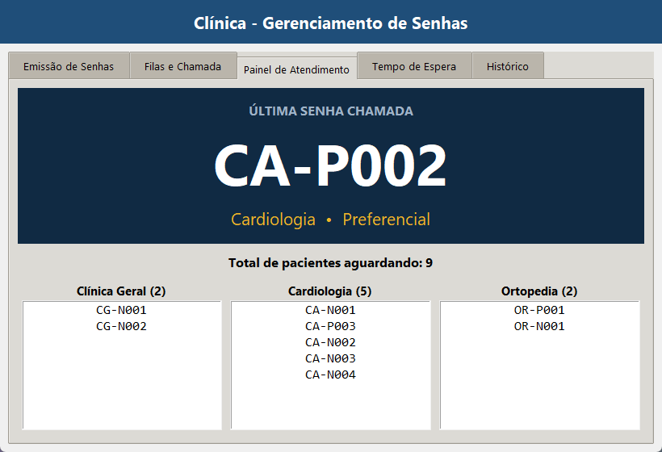
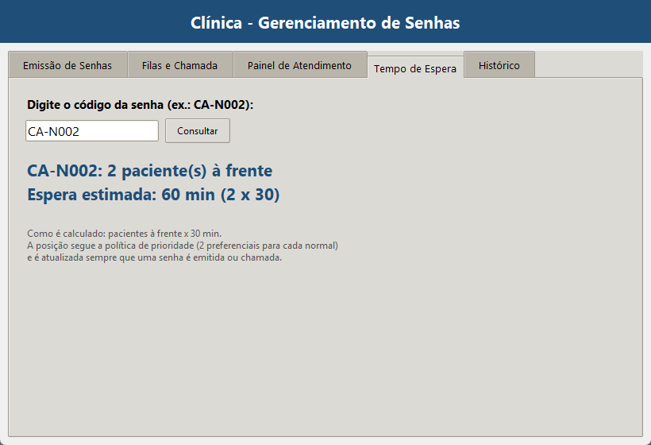
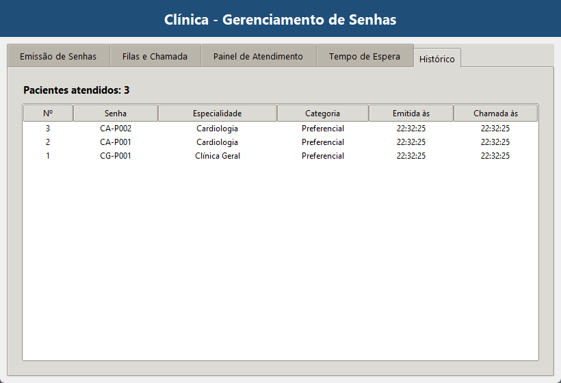

# Sistema de Gerenciamento de Senhas — Clínica Médica

Aplicação em **Python + Tkinter** que emite, organiza, consulta e chama senhas de atendimento de uma clínica com três especialidades, usando **filas FIFO** e uma **política de prioridade** para pacientes preferenciais.

|                                |                                                    |
| ------------------------------ | -------------------------------------------------- |
| **Disciplina**           | Estrutura de Dados II — Centro Universitário UDF |
| **Professora**           | Karla Sartin                                       |
| **Integrante**           | *Charlie César Dias de Castro*                  |
| **Vídeo demonstrativo** | https://youtu.be/gH8kzDyBlCo                     |

---

## Objetivo

Informatizar o controle das senhas da clínica para:

- organizar as filas de cada especialidade respeitando a ordem de chegada;
- garantir prioridade aos pacientes preferenciais sem abandonar os pacientes normais;
- informar o tempo estimado de espera de cada senha;
- registrar o histórico de atendimentos.

## Funcionalidades

A interface é uma janela com cinco abas:

| Aba                             | O que faz                                                                                                                                                                                                                                                  |
| ------------------------------- | ---------------------------------------------------------------------------------------------------------------------------------------------------------------------------------------------------------------------------------------------------------- |
| **Emissão de Senhas**    | Escolha da especialidade e do tipo de atendimento (Normal ou Preferencial). Gera a senha e mostra quantos pacientes estão à frente e a espera estimada.                                                                                                  |
| **Filas e Chamada**       | Mostra, por especialidade, a quantidade aguardando (total, preferenciais e normais) e a **ordem prevista de atendimento** com a espera de cada senha. O botão **Chamar próximo** retira a próxima senha seguindo a política de prioridade. |
| **Painel de Atendimento** | "Telão" com a **última senha chamada**, a especialidade, a categoria, o **total aguardando** e a **relação de senhas em espera** de cada especialidade.                                                                              |
| **Tempo de Espera**       | Consulta por código (ex.: `CA-N002`): pacientes à frente e tempo estimado. O resultado se atualiza sozinho a cada emissão ou chamada.                                                                                                                 |
| **Histórico**            | Todas as senhas já chamadas, com especialidade, categoria, hora de emissão e hora da chamada.                                                                                                                                                            |

Todas as abas são atualizadas automaticamente depois de cada emissão ou chamada.

### Especialidades e formato das senhas

| Sigla  | Especialidade  |
| ------ | -------------- |
| `CG` | Clínica Geral |
| `CA` | Cardiologia    |
| `OR` | Ortopedia      |

Formato: **`SIGLA-CATEGORIA` + número de 3 dígitos**, por exemplo `CA-N001`, `CA-P001`, `OR-N001`.
A numeração é **independente por especialidade e por categoria**. A sigla evita ambiguidade: a `N001` da Cardiologia (`CA-N001`) é diferente da `N001` da Ortopedia (`OR-N001`).

## Regra de prioridade adotada

Cada especialidade tem **duas filas FIFO independentes**: uma de preferenciais (P) e uma de normais (N).

Na chamada, é aplicada uma **política alternada 2:1**:

1. Se as duas filas têm pacientes, são chamados **até 2 preferenciais seguidos** e depois **1 normal**, e o ciclo se repete (P, P, N, P, P, N...).
2. Se só uma das filas tem pacientes, o próximo sai dela.
3. Se as duas estão vazias, o sistema avisa que não há pacientes aguardando.
4. Dentro de cada fila vale sempre a ordem de chegada (FIFO).

**Exemplo** — chegada na Cardiologia: `N001, N002, P001, N003, P002, P003`
Ordem de atendimento: `P001 → P002 → N001 → P003 → N002 → N003`

**Por que 2:1 e não "preferencial sempre primeiro"?** Com a prioridade estrita, num dia com muitos preferenciais um paciente normal poderia esperar indefinidamente. A política 2:1 mantém a prioridade (os preferenciais são chamados com o dobro da frequência) e garante que a fila normal também ande.
A proporção fica em uma única constante (`PREFERENCIAIS_POR_NORMAL` em `clinica/config.py`).

## Tempo estimado de espera

**Tempo estimado = pacientes à frente × 30 minutos**

Os "pacientes à frente" são contados na **ordem prevista de atendimento**, que é calculada simulando a política 2:1 sobre cópias das filas (as filas reais não são alteradas).

Hipóteses de funcionamento:

- cada especialidade tem **um médico**, que atende **um paciente por vez**;
- cada atendimento dura em média **30 minutos**;
- o paciente que já foi chamado (em atendimento) não entra na conta; com 0 à frente, a senha é a próxima a ser chamada;
- a estimativa é recalculada a cada emissão ou chamada. Por isso, a chegada de um preferencial pode aumentar a espera de pacientes normais.

## Estruturas de dados utilizadas

| Estrutura                                                             | Onde                                                                | Para quê                                                                                                                                                                                                           |
| --------------------------------------------------------------------- | ------------------------------------------------------------------- | ------------------------------------------------------------------------------------------------------------------------------------------------------------------------------------------------------------------- |
| **Fila FIFO — `collections.deque`**                          | `FilaEspecialidade.filas["N"]` e `filas["P"]`                   | Uma fila por especialidade e por categoria (6 filas no total). **Inserção** com `append()` no fim, ao emitir; **remoção** com `popleft()` do início, ao chamar. As duas operações são O(1). |
| **Fila de prioridade** (duas filas FIFO + política de escolha) | `FilaEspecialidade._categoria_da_vez()` e `chamar_proximo()`    | Decide de qual fila sai o próximo paciente, dando prioridade aos preferenciais na proporção 2:1, sem quebrar a ordem de chegada dentro de cada categoria.                                                        |
| **Dicionário — `dict`**                                     | `GerenciadorClinica.especialidades`, contadores e configurações | Acesso direto à fila de cada especialidade pela sigla (`"CA"`) e aos contadores de cada categoria.                                                                                                               |
| **Lista — `list`**                                           | `GerenciadorClinica.historico`                                    | Histórico das senhas chamadas, em ordem.                                                                                                                                                                           |
| **Classes**                                                     | `Senha`, `FilaEspecialidade`, `GerenciadorClinica`            | Organizam os dados e as operações de cada parte do sistema.                                                                                                                                                       |

**Consulta** às filas sem removê-las: `ordem_prevista()` (ordem de atendimento), `aguardando()` e `aguardando_por_categoria()` (quantidades) e `consultar_espera()` (posição e tempo de uma senha).

## Tratamento de exceções

| Situação                                   | Como o sistema trata                                                                         |
| -------------------------------------------- | -------------------------------------------------------------------------------------------- |
| Chamar com a fila vazia                      | A lógica levanta `FilaVazia`; a interface mostra o aviso "Não há pacientes aguardando". |
| Emitir sem escolher especialidade ou tipo    | A interface avisa o que falta e não emite.                                                  |
| Categoria ou especialidade inexistente       | A lógica levanta `ValueError` com a explicação.                                         |
| Consultar com o campo vazio                  | Mensagem "Digite o código de uma senha".                                                    |
| Consultar senha inexistente ou já chamada   | Mensagem informando que a senha não está aguardando.                                       |
| Código digitado com minúsculas ou espaços | Aceito normalmente (`" ca-n002 "` vira `CA-N002`).                                       |

## Organização do código

```
clinica-senhas/
├── main.py                     # ponto de entrada: abre a janela
├── clinica/                    # LÓGICA (não usa Tkinter)
│   ├── config.py               # especialidades, categorias, política 2:1 e tempo médio
│   ├── senha.py                # classe Senha (código CA-N001, horários)
│   ├── fila_especialidade.py   # 2 filas FIFO por especialidade, emissão, chamada, ordem prevista
│   └── gerenciador.py          # junta as 3 especialidades, histórico e tempo de espera
├── interface/                  # INTERFACE GRÁFICA (Tkinter)
│   ├── app.py                  # janela principal e abas
│   ├── opcoes.py               # textos das especialidades usados pelas abas
│   ├── aba_emissao.py
│   ├── aba_filas.py
│   ├── aba_painel.py
│   ├── aba_tempo.py
│   └── aba_historico.py
├── tests/
│   └── test_filas.py           # 17 testes automáticos da lógica
└── docs/img/                   # imagens deste README
```

A lógica fica separada da interface: as abas apenas leem os campos da tela, chamam o `GerenciadorClinica` e mostram o resultado. Todas usam **o mesmo** gerenciador, criado uma única vez em `app.py`.

## Tecnologias

- **Python 3.10 ou superior** (desenvolvido e testado no Python 3.13)
- **Tkinter / ttk** — interface gráfica
- **collections.deque** — filas FIFO
- **unittest** — testes automáticos
- **datetime** — horários de emissão e chamada

Todas fazem parte da biblioteca padrão do Python: **não é preciso instalar nenhum pacote**.

## Instalação e execução

1. Instale o Python 3.10+ (no Windows, mantenha marcada a opção **tcl/tk and IDLE** no instalador, que traz o Tkinter).
2. Baixe o projeto:
   ```bash
   git clone https://github.com/Charlie-Cesar/clinica-senhas.git
   cd clinica-senhas
   ```
3. Abra o sistema:
   ```bash
   python main.py
   ```
4. (Opcional) Rode os testes automáticos:
   ```bash
   python -m unittest discover -s tests -v
   ```

## Testes automáticos

`tests/test_filas.py` verifica:

- numeração separada por categoria e independente por especialidade;
- FIFO dentro da mesma categoria;
- preferencial chamado antes de um normal que chegou antes;
- política 2:1 (`P, P, N, P, P, N`);
- erro tratado ao chamar com a fila vazia;
- registro no histórico e na última chamada;
- contagem de pacientes aguardando (total e por categoria);
- tempo de espera = pacientes à frente × 30, atualizado após cada chamada;
- consulta sem remover ninguém da fila;
- erros para categoria, especialidade ou senha inválidas.

## Imagens da interface

**Emissão de senhas**


**Filas e chamada** — ordem prevista com a política 2:1 e espera de cada senha


**Painel de atendimento**


**Consulta do tempo de espera**


**Histórico de atendimentos**

